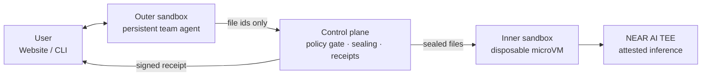
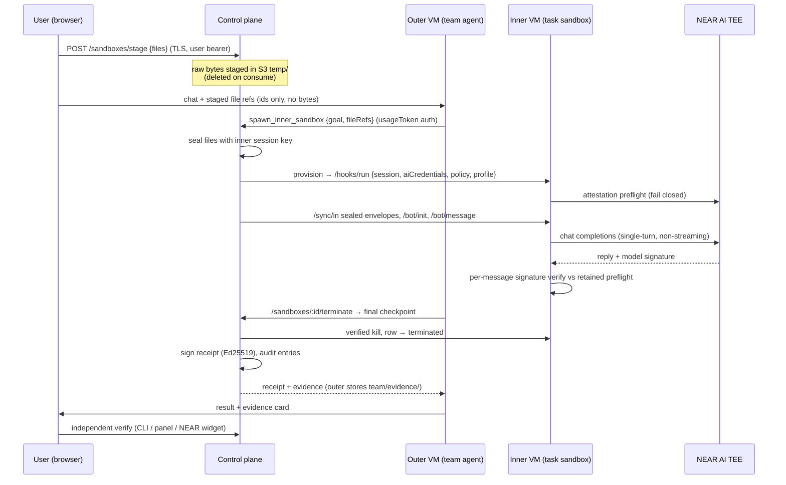

# Wayfind ONE: ephemeral environments for a verifiable AI workforce

Wayfind ONE lets teams use AI on sensitive code, contracts, and records without sending them to a chatbot.
Each sensitive task runs in a disposable microVM, with attested NEAR AI inference, per-response signature
checks, and a signed receipt that can be checked offline.

It gives a team an always-on AI workforce. You create a teammate, such as an HR bot, and train it on your criteria: what to check and what to flag. Sensitive files, such as a candidate's resume, go to a fresh inner sandbox for review. The sandbox is then destroyed, and you get back the result and a signed receipt. The team agent handles planning and everyday chat, but it never receives the sensitive file.

## Quick links

- Platform: https://one.wayfind.click
- Signed sample receipt (Ed25519, passes `wayfind verify` offline; a trivial test question with no personal data): [signed-receipt-sample.json](signed-receipt-sample.json)
- Backend repo (baseline, not submitted): https://github.com/tamago-labs/wayfind-cloud
- Product vision: [docs/PIVOT.md](docs/PIVOT.md)

## The problem

Useful AI lives behind someone else's API, and teams that handle sensitive material face three choices:

- **Send it to a chatbot.** Legal, security, and compliance teams reject this for proprietary code, contracts, financials, or patient data.
- **Self-host the models.** This needs GPU infrastructure, model operations, and security hardening that most teams do not have.
- **Do without AI.** The work stays manual, slow, and dependent on individual people.

Wayfind ONE is the middle path. You upload a workspace, pick a task and model, and it runs in an isolated microVM with attested inference. You get the result plus evidence, so a security review can check files instead of relying on promises.

## How NEAR fits

- **Inference (NEAR AI Cloud):** each disposable microVM calls NEAR AI for model answers. A task can run on `Qwen/Qwen3.8-27B` (default), `z-ai/glm-5.3-flash`, or `deepseek-ai/DeepSeek-V4.1-Flash-1017`. Attestation-grade tasks use non-streaming calls, because streams cannot carry model-TEE signatures.
- **Attestation:** before the first prompt, the microVM checks NEAR AI's attestation report (fresh nonce, `signing_algo=ecdsa`) and an NVIDIA verdict via NRAS. Each reply is then checked against the request hash, response hash, model, and signer. Implementation in `packages/sandbox/src/`.
- **Proof kit:** [`scripts/near-ai-tests/`](scripts/near-ai-tests/) (tests `00`–`07`, with measured results in [FINDINGS.md](scripts/near-ai-tests/FINDINGS.md)).
- **Evidence surface:** the NEAR Verification Center widget renders our retained attestation as verification reports. It checks report structure only. Our own CLI and panel checks are the trust anchor.

## Try it (judge path)

Website: https://one.wayfind.click. Demo account: `pisuthd@outlook.com` / `Demodemo@1234` (or your own account).

CLI (Node >= 20, no account needed; clone this repo first):

```
npm install

# 1. Live end-to-end: HR bot, sealed sheet, sandbox review, signed receipt (~2 min)
npm run demo
# expect: a leave-balance review flagging 2 employees, then
#   demo: ALL CHECKS PASSED
# (10 receipt checks incl. Ed25519, 1/1 attested response, 8 NVIDIA GPUs)
#
# Real output looks like this:
#   [demo:auth] using embedded demo bundle credential
#   [demo:computer] 5409dc04… already running
#   [demo:config] escalation mode → auto-logged (restored after demo)
#   [demo:bot] Judge-11131317 (0b66ad96…)
#   [demo:stage] leave-balances.csv sealed [6035b835…]
#   [demo:run] 2c41be5f… — streaming:
#   [… per-employee breakdown flags E002 (22 days, −2 balance) and E003 (31 sick days) …]
#   [demo:receipt] signed · Qwen/Qwen3.8-27B · microvm-4adfc1f…
#     PASS  version is wayfind-receipt/v0 — wayfind-receipt/v0
#     PASS  class is observed or signed — signed
#     PASS  required fields present — 6/6
#     PASS  final snapshot sealed at close — sha256 f552666cdac7…
#     PASS  terminated after provisioned — 2026-11-13T13:11:36 → 2026-11-13T13:12:24
#     PASS  VM cleanup verified at terminate — true
#     PASS  inference responses verified vs retained attestation — 1/1 checked valid
#     PASS  preflight nonce fresh, model TEEs present — 1 node(s)
#     PASS  NVIDIA verdict clean at preflight — 8 GPUs
#     PASS  Ed25519 receipt signature verifies (offline) — kid 218ecd601d93b709
#   demo: ALL CHECKS PASSED
#   [demo:cleanup] demo bot deleted
#   demo done in 1.1m — computer left running for the next run

# 2. Inspect what the demo closed
node ./bin/wayfind.js sandboxes --closed
# expect: "Review these leave balances…" · Closed x ago · 1 of 1 steps verified · receipt: signed

# 3. Re-verify any run by id (paste the sandbox id printed in step 2)
node ./bin/wayfind.js verify microvm-…
# expect: ALL CHECKS PASSED
```

The `npm run demo` run ends with a real signed receipt (`class: signed` plus an Ed25519 signature). It is verified locally with no account beyond the embedded throwaway credential. The bundled example receipt is an offline shape check: it proves the pipeline, not a live attestation.

Other CLI commands: `login`, `logout`, `run`, `status`, `stop`, `export`, `chat`, `policy`, `audit`, `evidence`, `image-trust` (verifies the published sandbox image record against the control-plane signature, offline).

## Architecture

### System overview

Wayfind ONE uses a dual-sandbox model:

- **Outer sandbox:** one persistent computer per user. It runs the team agent (bots, history, config) and everyday chat. It never receives sensitive file bytes.
- **Inner sandbox:** one disposable Firecracker microVM per sensitive task. Files arrive sealed, inference is NEAR-only and attested, and the VM is destroyed after the task.



Two repositories:

| Repo | Holds | Deploys to |
|---|---|---|
| `wayfind-one` (this repo) | Website (`frontend/`, Next.js 15), CLI (`bin/`, `src/`), inner sandbox image (`packages/sandbox`), outer agent image (`packages/outer-sandbox`), NEAR proof kit (`scripts/near-ai-tests/`) | Frontend hosting; both images published as golden MicroVM images |
| `wayfind-cloud` | Amplify Gen 2 backend: Cognito auth, `wayfind-api` Lambda, DynamoDB models, S3 sync buckets | AWS Amplify |

Both share one Cognito user pool. The website uses direct login, and the CLI uses the device flow (`XXXX-XXXX` → `CliToken`). Both resolve to the same `ownerId`.

### Models

Each sandbox runs its agent on one of these models.

| Role | Model | Where it runs |
|---|---|---|
| Inner sandbox (default) | `Qwen/Qwen3.8-27B` | NEAR AI Cloud TEE, attested |
| Inner sandbox | `z-ai/glm-5.3-flash` | NEAR AI Cloud TEE, attested |
| Inner sandbox | `deepseek-ai/DeepSeek-V4.1-Flash-1017` | NEAR AI Cloud TEE, attested |
| Outer team agent | Meta Muse Spark Open | Modal-hosted server (no attestation claim) |

Inner-sandbox models are selectable per run. Outer-agent output is `observed` only: it is not attested.

### Nested sandbox: outer-blind file flow

The outer agent never touches sensitive bytes. Files travel sealed end to end:



### Lifecycle of one inner run

1. **Create:** the user picks a bot (or ad hoc task), a model, and a security level, and attaches files. The CLI can also provision directly.
2. **Provision:** the backend boots a disposable microVM, mints a per-session bearer, and records a session row. Policy gates fail closed here.
3. **Attest:** the VM runs its preflight (fresh nonce, per-node echo, NVIDIA verdict). If it fails, the session stops before any prompt is sent.
4. **Work:** messages append to a hash-chained transcript. Each runs one non-streaming inference, and the response signature is verified against the retained preflight.
5. **Checkpoint:** sealed transcript snapshots are stored on demand and always at terminate. Blobs are opaque to the backend. Manifests are hashes.
6. **Terminate:** final snapshot, evidence pull, verified VM kill, keys revoked. A receipt is built and signed.
7. **Verify:** CLI, website panel, and NEAR widget check the same evidence.

One open sandbox per thread: follow-ups reuse the live sandbox. It closes after 30 minutes idle, on `close_inner_sandbox`, or when the computer terminates. Nesting is capped at 2: the inner image has no escalation tool.

### Trust boundaries

| Boundary | Rule | Enforced by |
|---|---|---|
| Browser → control plane | Cognito JWT (web) or CLI token (CLI); outer calls use per-computer `usageToken` | `verifyToken` gate + dual-auth route handlers |
| Outer VM → sensitive bytes | Never. Outer sees file ids and names only | Staged upload path; outer has no sealing key |
| Inner VM → inference | NEAR-only. Meta key is parse-utility-only, never inference | In-image run policy (fail closed, `403`/`501`) |
| Inner VM → escalation | None (nesting cap 2) | No escalation tool in the inner image |
| Evidence → tampering | Hash-chained transcripts, sealed checkpoints, signed receipts, append-only audit | `verifyReceipt` (CLI + panel) + NEAR widget |
| Images → supply chain | Build pipeline plus control-plane-signed trust record, checked offline | `scripts/image`, `scripts/outer-image`, `wayfind image-trust` |

### Verification (three paths, same evidence)

The evidence bundle (receipt, transcript chain, and NEAR attestation reports) is checked three ways: `wayfind verify` (CLI), the Verify tab and Sandboxes panel (website), and the NEAR Verification Center widget. They must all agree.

A receipt binds `{ outerComputerId, innerSandboxId, taskDescriptorHash }` (nesting proof) and is signed Ed25519 by the control plane. Modify one byte of a saved copy and the signature check fails while shape checks still pass. The demo shows this.

### Code map

- Outer agent loop, team-as-files, escalation tool, approvals: `packages/outer-sandbox/src/`
- Outer image pipeline: `packages/outer-sandbox/scripts/outer-image/`
- Inner sandbox (bot runner, `/ai`, attestation, sealed checkpoints): `packages/sandbox/src/`
- Inner image pipeline and trust publish: `packages/sandbox/scripts/image/`
- Website (landing, chat, Sandboxes panel, Verify tab): `frontend/`
- CLI: `bin/wayfind.js`, `src/commands/`
- NEAR attestation proof kit: `scripts/near-ai-tests/`

## Tracks

- **`privacy`**: private AI. Sealed workspaces, TEE-attested NEAR inference, encrypted checkpoints, and no file bytes outside the attested VM.
- **`security`**: agent sandboxing with fail-closed policy enforcement, signed image trust records, per-response signature verification, and an append-only audit trail.

## Known limits

- Strict-confidential execution (hardware-attested worker, Phase 3 AWS Nitro backend) is **not built**. Requests for that level fail closed and never silently downgrade.
- Outer-agent inference (Meta Muse Spark Open via Modal) is not attested. Claims about the outer agent are `observed` only.
- Only inner-sandbox inference is verified per response. Streamed responses carry gateway signatures, not model-TEE signatures, so attestation-grade tasks use non-streaming calls.
- Full TDX quote verification is deferred to the upstream NEAR verifier.

## Baseline disclosure

Per hackathon rules Q-002 to Q-005:

- [`wayfind-cloud`](https://github.com/tamago-labs/wayfind-cloud) (Amplify backend, classic computer image, dashboard) predates the hackathon window and is baseline infrastructure, not the submission.
- Built in-window in **this repo**: nested-sandbox architecture, attested-inference path with per-message verification, signed execution receipts, outer-blind sealed file flow, evidence bundle with three-way verification, and the NEAR attestation proof kit.
- Pre-existing libraries, the Amplify scaffold, and AI-assisted code are baseline or tooling per Q-005.
- Hackathon diff: `https://github.com/tamago-labs/wayfind-one/compare/<pre-hackathon-tag>...<hackathon-submission-tag>` (tags are cut at submission; this placeholder is replaced then).

## License

MIT. See [LICENSE](LICENSE).
