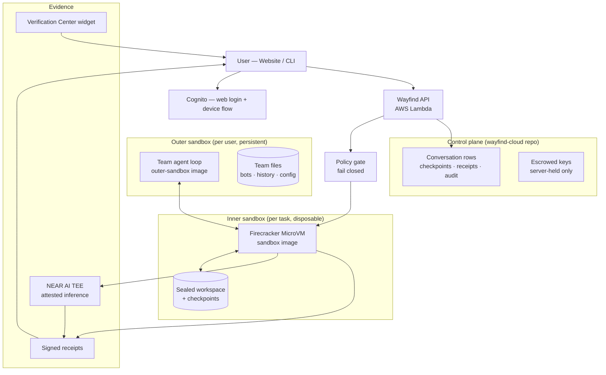
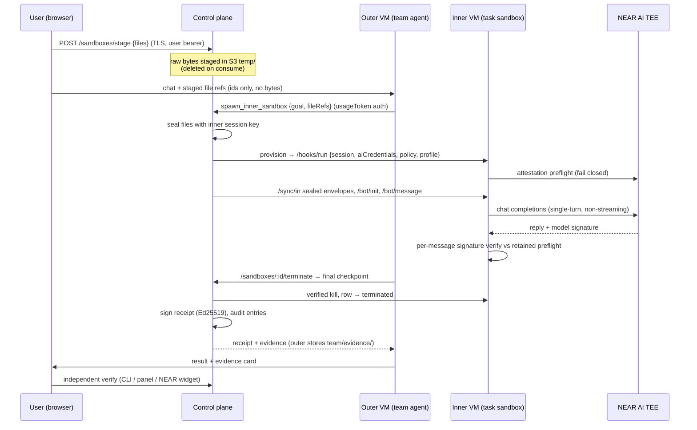
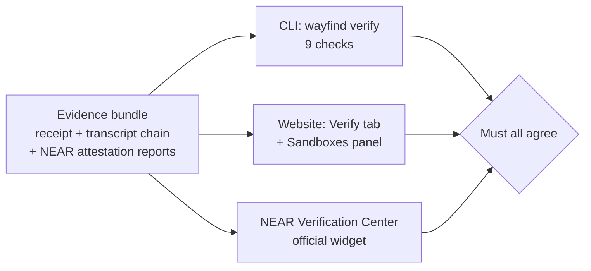

# Wayfind ONE — System Architecture

> Verifiable private AI execution as a service: disposable Firecracker microVMs,
> attested NEAR AI inference, signed receipts, independent verification.

This document describes the system **as built**. Forward-looking plans live in
`PLAN-P2*.md` / `PIVOT.md` and are marked as such where referenced.

## 1. System overview

Two repositories:

| Repo | Holds | Deploys to |
|---|---|---|
| `wayfind-one` (this repo) | Website frontend (`/frontend`, Next.js 15), CLI (`bin/`, `src/`), sandbox agent image (`packages/sandbox`), outer agent image (`packages/outer-sandbox`), NEAR attestation proof kit (`scripts/near-ai-tests/`) | Frontend hosting; both images published as golden MicroVM images |
| `wayfind-cloud` | Amplify Gen 2 backend: Cognito auth, `wayfind-api` Lambda (all `/conversations`, `/computer`, `/sandboxes`, `/policy`, `/audit`, `/evidence` routes), DynamoDB models, S3 sync buckets | AWS Amplify (API + data + storage) |

They share one Cognito user pool: the website uses direct login, the CLI uses the device flow (`XXXX-XXXX` → `CliToken`), both resolving to the same `ownerId`.

## 2. The nested-sandbox core (outer-blind escalation)

The outer agent never touches sensitive bytes. Files travel sealed end-to-end:

Key invariants:

- The outer VM holds **no inner bearer** — it relays through `/sandboxes/:id/*` and the control plane holds the session token server-side.
- The inner VM holds **no Meta key** — parsing inside uses the injected NEAR-adjacent utility key only for document parsing; inference is NEAR-only and pinned by the run policy the image itself enforces.
- `spawn_inner_sandbox` is a **bounded tool call**, never a handoff: the outer agent stays responsible for the final answer. Nesting caps at 2 (inner has no escalation tool — the call fails closed).
- One open sandbox **per thread**: follow-ups reuse the live sandbox (transcript + files persist); idle 30 min, explicit `close_inner_sandbox`, or computer terminate ends the session with one signed receipt.

## 3. Conversation lifecycle (per inner run)

A task moves through the following stages:

1. **Create:** the customer picks a bot (or ad-hoc), a curated model, a security level, and attaches files — or the CLI provisions directly.
2. **Provision:** the backend boots a disposable microVM, mints a per-session bearer, wraps a per-conversation key for escrow, and records a session row. Policy gates fail closed here.
3. **Attest:** the in-VM bot runs its preflight (fresh nonce, per-node echo, NVIDIA verdict) — retained for the session, or the session fails before any prompt is sent.
4. **Work:** messages append to a hash-chained transcript; each runs one non-streaming inference with the workspace in context, then the response signature is verified against the retained preflight.
5. **Checkpoint:** sealed transcript snapshots are stored on demand and always at terminate. Blobs are opaque to the backend; manifests are hashes.
6. **Terminate:** final snapshot, evidence pull, verified VM kill, keys revoked. A receipt is built and signed — history renders later, decrypted client-side.
7. **Verify:** CLI, website panel, and the NEAR widget check the same evidence three independent ways.

## 4. Trust boundaries

| Boundary | Rule | Enforced by |
|---|---|---|
| Browser → control plane | Cognito JWT (web) or CLI token (CLI); outer calls use per-computer `usageToken` | `verifyToken` gate + dual-auth route handlers |
| Outer VM → sensitive bytes | Never. Outer sees file ids/names only | Staged upload path; outer has no sealing key |
| Inner VM → inference | NEAR-only; Meta key is parse-utility-only, never inference | In-image run policy (fail closed, `403`/`501`) |
| Inner VM → escalation | None (nesting cap 2) | No escalation tool in the inner image |
| Evidence → tampering | Hash-chained transcripts, sealed checkpoints, signed receipts, append-only audit | `verifyReceipt` (CLI + panel) + NEAR widget |
| Images → supply chain | Reproducible builds + SBOM, control-plane-signed trust record, `verify` offline | Image pipeline (`scripts/image`, `scripts/outer-image`) + `image-trust` command |

## 5. Verification (three independent paths, same evidence)

A receipt binds `{ outerComputerId, innerSandboxId, taskDescriptorHash }`
(nesting proof) and is signed Ed25519 by the control plane. Tamper with one
byte of a saved copy and the signature check fails while shape checks pass —
this is the expected demo.

## 6. What each piece is (file map)

- Outer agent loop + team-as-files (bots/history/config), escalation tool,
  approvals/question cards: `packages/outer-sandbox/src/`
- Outer image pipeline (package → create → smoke → terminate):
  `packages/outer-sandbox/scripts/outer-image/`
- Inner sandbox image (bot runner, `/ai`, attestation, sealed checkpoints,
  profile-gated tools): `packages/sandbox/src/`
- Inner image pipeline + trust publish: `packages/sandbox/scripts/image/`
- Website (landing, OneShell, TeamChat, Sandboxes panel, Verify tab):
  `frontend/`
- CLI (13 commands incl. verify/policy/audit/evidence/image-trust):
  `bin/wayfind.js`, `src/commands/`
- NEAR attestation proof kit (00–11 model tests + findings):
  `scripts/near-ai-tests/`

## 7. Hackathon-built vs baseline (disclosure)

Per the NEAR HACKATHON rules (Q-002–Q-005): `wayfind-cloud` (backend,
classic computer image, dashboard) predates the hackathon window and is the
baseline. Everything NEAR-specific was built in-window in this repo: the
nested-sandbox architecture, the attested-inference path with per-message
verification against retained preflights, signed execution receipts, the
outer-blind sealed file flow, the evidence bundle + three-way verification,
and the NEAR attestation proof kit. Pre-existing libraries, the Amplify
scaffold, and AI-assisted code are baseline/tooling per Q-005.
